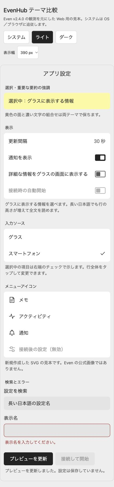
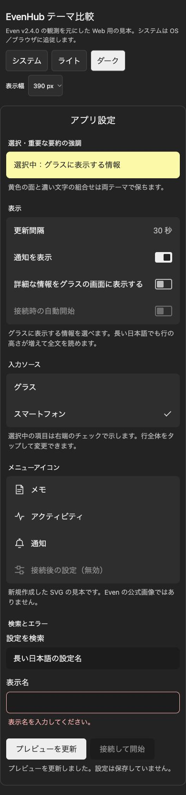

# EvenHub Theme Design

EvenHub アプリのスマートフォン側 WebView を、Even アプリのライト／ダークテーマに合わせるための Codex スキルです。

## サンプル

| ライトテーマ | ダークテーマ |
|---|---|
|  |  |

2026-10-28に撮影した、幅390pxのWeb見本のキャプチャです。Even本体やグラス実機の画面ではありません。下部メニュー追加前の基本部品を示しています。現在の見本を動かす手順は [プレビュー](#プレビュー) を参照してください。

## できること

- 観測した色を役割別のCSSトークンへ対応付ける
- 文字・余白・カード・2値のスライド式トグルを揃える
- 9言語の見本で長い欧文とCJKの折返しを比較する
- モノクロのSVGメニューアイコンと透過PNGを制作する
- 下部メニューとsafe areaの間に意図しない線を作らない

**非公式のコミュニティ資料です。** Even Realities の公式デザインシステム・公式翻訳辞書ではありません。Even v2.4.0（2026-10-28）の実画面を参考にした近似と実装上の推奨を区別しています。G2グラス自体の描画やアプリ配布は対象外です。

## インストール

このリポジトリのルートがスキルフォルダです。Codex のスキル保存先へクローンします。同名フォルダがある場合は別の場所へクローンして内容を比較してください。

```sh
mkdir -p "${CODEX_HOME:-$HOME/.codex}/skills"
git clone https://github.com/3mintimer/evenhub-theme-design.git \
  "${CODEX_HOME:-$HOME/.codex}/skills/evenhub-theme-design"
```

スキル一覧を再読み込みするか、新しい会話で次のように依頼します。

```text
$evenhub-theme-design を使って、この EvenHub アプリのスマートフォン画面とメニューアイコンをライト／ダーク両テーマに合わせてください。
```

スキルの入口は [SKILL.md](SKILL.md) です。他のスキル実行環境でも、このファイルから関連リファレンスを読めます。

## プレビュー

[assets/theme-preview.html](assets/theme-preview.html) をブラウザで開きます。ライト／ダーク／OS追従、表示幅、9言語、下側余白0 / 20 / 34pxを切り替えられます。余白値は比較用の模擬値です。

外部SVGの読み込みが制限されるブラウザでは、Python 3 のローカルサーバーで開けます。

```sh
python3 -m http.server 8000 --bind 127.0.0.1 --directory assets
```

ブラウザで `http://localhost:8000/theme-preview.html` を開きます。プレビューはCSS・JavaScript・SVGだけで動き、外部フォントやCDNを使いません。Even本体の原本キャプチャや個人データは同梱していません。

## 内容

| ファイル | 用途 |
|---|---|
| [SKILL.md](SKILL.md) | エージェント向けの設計・実装・確認手順 |
| [design-reference.md](references/design-reference.md) | 配色、寸法、部品、下部の線の対策 |
| [localization.md](references/localization.md) | 9言語とCJKの扱い |
| [menu-icons.md](references/menu-icons.md) | SVGと透過PNGの作り方 |
| [observations.md](references/observations.md) | 観測・推奨・未確認事項の区別 |
| [even-theme.css](assets/even-theme.css) | 取り込み用CSSと任意の下部メニュー用クラス |
| [icons](assets/icons/) | 新規作成した4種の24×24 SVG |

PNG出力だけは Node.js と `sharp` が必要です。導入とコマンドは [menu-icons.md](references/menu-icons.md) を参照してください。通常のスキル利用・CSS・プレビューに依存パッケージは不要です。

## 確認

Node.js で、ローカル参照・翻訳キー・JavaScript構文・SVG・配布ファイルの基本的な確認を実行できます。

```sh
node scripts/check.cjs
```

ブラウザでの見た目、Even内WebViewでのテーマ／言語同期、物理グラスはそれぞれ別に確認します。検証範囲は [observations.md](references/observations.md) を参照してください。

## ライセンス

このリポジトリの文書・コード・新規SVGは [MIT License](LICENSE) です。製品名・商標の権利は各権利者に帰属します。
